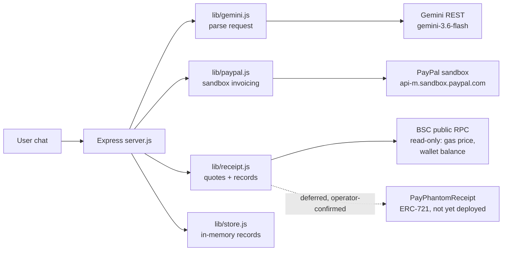
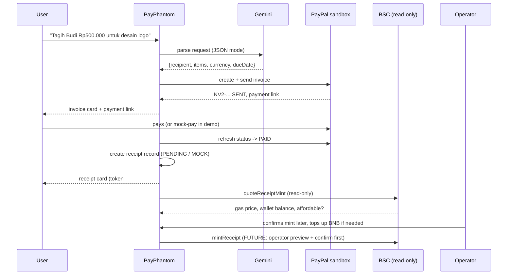

# Design — PayPhantom

> Spec for the Kiroween 2026 Frankenstein entry. Status: scaffold (2026-11-13).
> Companions: `requirements.md` (what), `tasks.md` (in what order).

## Overview

PayPhantom is a small Node 24 + Express app (no build step, vanilla JS
frontend) that stitches three systems: Gemini (chat parsing), PayPal
Invoicing API v2 sandbox (billing), and BNB Chain (ERC-721 receipt).
The server never holds keys for the chain: receipt minting is deferred and
operator-confirmed by design (see "Receipt minting" below).

## Architecture



### Components

| Component | Responsibility |
|---|---|
| `server.js` | HTTP routes, chat flow, invoice + receipt endpoints, static UI |
| `lib/gemini.js` | Plain-language -> invoice JSON (Gemini REST, JSON mode, temperature 0.2). TODAY computed from the server clock (Asia/Makassar), not hard-coded. |
| `lib/paypal.js` | PayPal OAuth token cache, Invoicing v2 create/send/get, mock mode. Knows the PayPal quirk: create returns 201 with only a self link; the id is parsed from the href. |
| `lib/receipt.js` | Receipt records (PENDING/MOCK), read-only gas quotes via public BSC RPC. No signing. |
| `lib/store.js` | In-memory Maps for invoices and receipts (no persistence by design). |
| `public/` | Chat UI + invoice cards + receipt cards (vanilla JS). |
| `contracts/src/PayPhantomReceipt.sol` | ERC-721 receipt sketch (OpenZeppelin). Owner-only `mintReceipt`, on-chain base64 JSON `tokenURI`, one receipt per invoice id. |
| `scripts/mcp-payphantom.mjs` | Minimal stdio MCP server: one read-only tool, `receipt_gas_quote`. |

## End-to-end flow



## Data model

### Invoice (stored)

```js
{
  id,            // PayPal id, e.g. INV2-XXXX-...
  number,        // PP-<base36> human number
  recipientName, recipientEmail,
  currency,      // "IDR" | "USD"
  total,         // plain number
  dueDate,       // "YYYY-MM-DD" | null
  status,        // SENT | PAID | ...
  paymentUrl,
  createdAt
}
```

### Receipt (stored)

```js
{
  id,            // RCPT-<base36>
  invoiceId, invoiceNumber,
  payerName, payerEmail,
  amount, currency,
  paidAt,
  status,        // PENDING (live, deferred) | MOCK (demo) | MINTED (after on-chain mint)
  tokenId,       // number once minted (simulated in MOCK)
  txHash,        // set once minted
  contractAddress // set once PayPhantomReceipt is deployed
}
```

## API

| Method | Path | Purpose |
|---|---|---|
| GET | `/api/health` | ok, mode, gemini, paypal, receipt=deferred |
| POST | `/api/chat` | parse + create + send invoice |
| GET | `/api/invoices` | list stored invoices |
| GET | `/api/invoices/:id` | one invoice (live mode refreshes from PayPal) |
| POST | `/api/invoices/:id/mock-pay` | mock only: mark PAID + create MOCK receipt |
| POST | `/api/invoices/:id/receipt/quote` | read-only gas quote |
| POST | `/api/invoices/:id/receipt/request` | record a receipt (409 unless PAID) |
| GET | `/api/receipts` | list receipts |
| GET | `/api/receipts/:id` | one receipt |

## Receipt minting — the deferred design (decision record)

**Context (2026-11-13):** the operator wallet holds ~0.000351 BNB. A
receipt mint costs ~120-150k gas, about 0.00012-0.00015 BNB at 1 gwei.
That is ~2-3 mints of runway, and the wallet is also the user's only BNB.

**Decision:** minting is deferred and optional, in three layers:

1. **Record first, mint later.** Every paid invoice gets a receipt record
   immediately (PENDING in live mode). The record is the proof of intent;
   the chain mint is a second, separate, operator-confirmed step.
2. **Quote before mint.** `quoteReceiptMint()` reads gas price + wallet
   balance from public RPC and reports affordability. No mint is attempted
   when `affordable` is false.
3. **No server signing.** This server holds no private key and implements
   no broadcast path. The future mint step runs through the operator's
   wallet tool with a preview the operator confirms per mint (the same
   preview-then-confirm rule used for all of the operator's on-chain work).

**Alternatives considered and rejected:**
- *Auto-mint on payment*: rejected — would drain the operator's tiny BNB
  balance without consent and could fail mid-demo.
- *Payer funds the mint at checkout*: kept as a future option, not built —
  it needs a checkout UX the demo does not have yet.
- *Skip the chain half entirely*: rejected — the on-chain receipt is the
  Frankenstein; without it the entry is just PayPilot again.

## Contract sketch (contracts/src/PayPhantomReceipt.sol)

- ERC-721 (`PayPhantomReceipt`, `PPR`), OpenZeppelin, Solidity 0.8.28.
- `mintReceipt(to, invoiceId, invoiceNumber, payerEmail, amount, currency,
  paidAt)` — `onlyOwner`, one receipt per invoice id (reverts on duplicate).
- `receiptOf(tokenId)`, `tokenByInvoice(invoiceId)` view helpers.
- `tokenURI` returns fully on-chain base64 JSON with an inline SVG image
  (no IPFS, no external hosting).
- Not audited, not deployed. Deploy + verify is a build-phase task.

## Kiro usage (for the Devpost write-up)

- **Specs:** this directory — requirements first, then design, then tasks;
  implementation follows `tasks.md` wave by wave.
- **Steering:** `.kiro/steering/` — product, tech, structure, security
  (always-on). The security file is why no secret ever lands in the repo.
- **Hooks:** `.kiro/hooks/quality-gates.json` — `node --check` on every saved
  `.js` file (PostFileSave) and a pre-finish reminder (Stop) to run tests
  and check for staged secrets.
- **MCP:** `.kiro/settings/mcp.json` — a local stdio server
  (`scripts/mcp-payphantom.mjs`) exposing `receipt_gas_quote`, so the agent
  can quote a mint without touching keys.
- **Powers/skills:** none yet; a Foundry power is the candidate when the
  contract moves from sketch to deploy.

## Error handling

- Gemini down / key missing: chat replies gracefully, HTTP 200, no crash.
- PayPal rejects: the PayPal error text is surfaced to the user (e.g. a 403
  NOT_AUTHORIZED means the sandbox app lacks the Invoicing permission).
- BSC RPC unreachable: the quote endpoint answers 502 with the reason; the
  rest of the app keeps working (receipts stay PENDING).
- Unknown invoice/receipt id: 404. Receipt request on an unpaid invoice: 409.

## Testing strategy

- `npm test` (node:test, offline-safe): mock invoice create + store +
  mock-pay + MOCK receipt; live-mode receipt record is PENDING with no
  tokenId/txHash; receipt quote shape (skipped cleanly when BSC is
  unreachable).
- Manual demo script for the video: start in mock mode, chat an invoice,
  mock-pay it, show the MOCK receipt; then switch to live sandbox for one
  real invoice and show the PENDING receipt + gas quote.
- Contract: compile + a Foundry test for mintReceipt (duplicate revert,
  tokenURI shape) once the deploy task starts — not in the scaffold.
